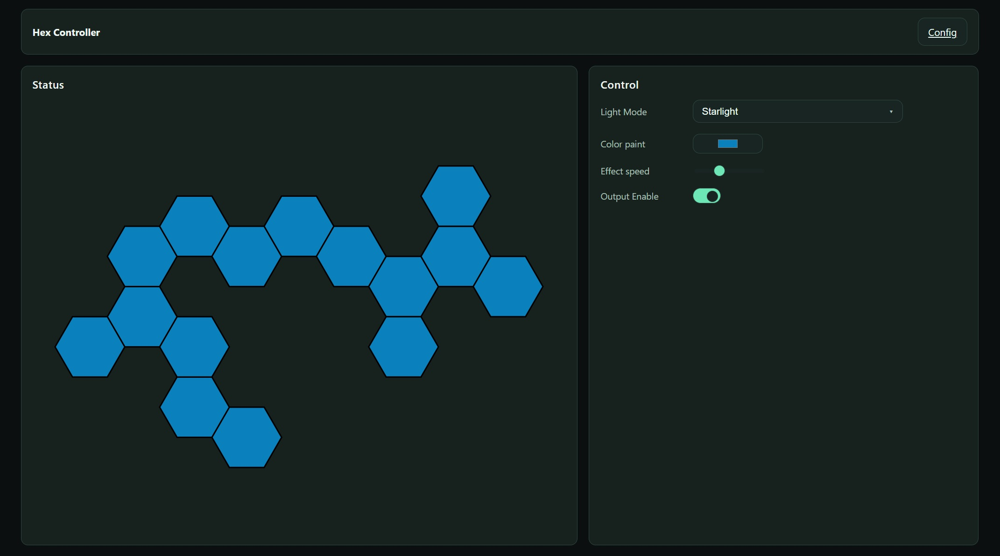
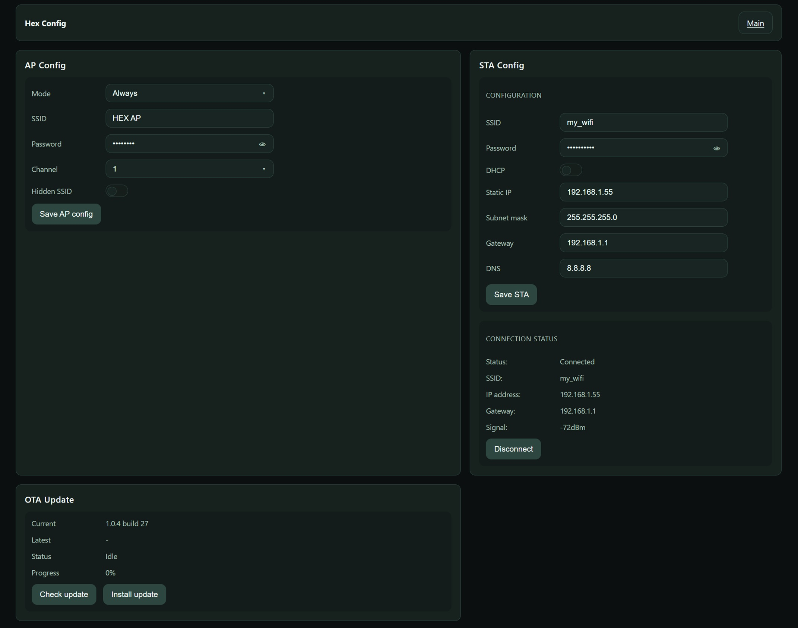

# ESP32 Hexagons LED Controller

A Wi-Fi LED controller for modular hexagonal LED panels with a browser UI, non volatile storage and secure OTA firmware updates.

---

## Project Overview

The system is built around a single ESP32 firmware application responsible for:

- driving the LED,
- hosting the web interface,
- handling network configuration,
- storing configuration settings in NVS,
- managing OTA firmware updates,
- communicating with a local Linux server.

---

## User Interface

The controller exposes a local HTTP server available from local WiFi network or Access Point created by ESP32.

The main UI provides:

- visual preview of the hexagon layout,
- interactive color painting on individual hexagons,
- light mode selection,
- output enable control,
- effect speed adjustment,
- responsive layout for desktop and mobile devices.

## Configuration Interface

A separate configuration page provides access to maintenance and system settings.

Available configuration options include:

- Wi-Fi configuration,
- AP/STA mode management,
- DHCP/static IP selection,
- firmware version inspection,
- OTA update installation,
- OTA progress monitoring,
- system diagnostics.

---

## Main Features

### Networking

- STA + AP operating modes
- automatic AP fallback when STA connection fails
- configurable AP settings
- configurable STA settings
- DHCP and static IP support
- recovery button for forced AP mode
- persistent network configuration storage

### LED Control

- static color mode
- dynamic lighting effects
- adjustable effect speed
- dynamic LED preview
- synchronized firmware

### Reliability Features

- secure OTA firmware updates
- SHA-256 firmware verification
- firmware version checking
- staged OTA validation
- automatic rollback after failed update
- OTA status reporting to server backend
- deferred NVS writes to reduce flash wear
